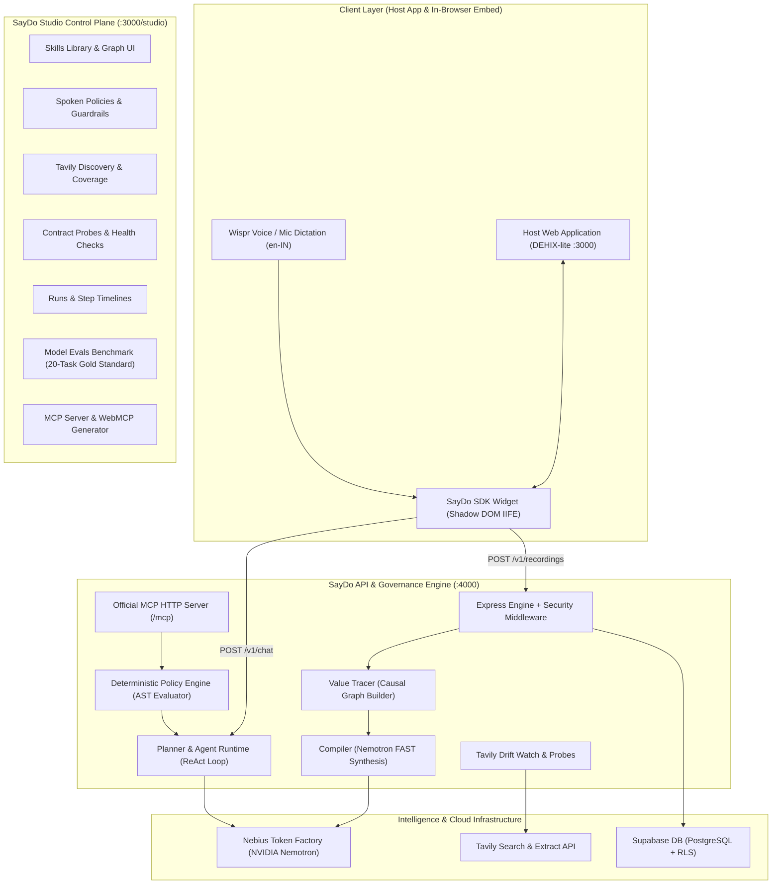
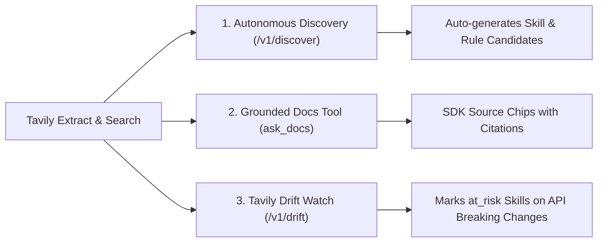

# ⚡ SayDo: Voice-First Agent Enablement & Neuro-Symbolic Governance Platform

[]()
[]()
[-emerald.svg)]()
[](https://opensource.org/licenses/MIT)

> **"Show it once. Speak your rules. Run everywhere."**  
> SayDo turns any web application into a fully autonomous, policy-governed AI agent in minutes. By simply demonstrating workflows in the browser while speaking natural-language explanations, SayDo synthesizes typed agent tools, infers cross-step causal data dependencies, enforces spoken safety guardrails, continuously guards against API contract drift using **Tavily**, and exports tools to the **Model Context Protocol (MCP)** and **Chrome WebMCP**.

---

## 🔗 Quick Links & Demos
- 🌐 **Live Web Application & DEHIX-lite Demo**: [https://saydo-demo.vercel.app](https://saydo-demo.vercel.app) *(or `http://localhost:3000`)*
- 🎛️ **SayDo Studio Governance Control Plane**: [https://saydo-demo.vercel.app/studio](https://saydo-demo.vercel.app/studio)
- 📹 **Video Walkthrough & Architecture Tour**: [Watch on YouTube](https://youtu.be/saydo-demo-walkthrough)
- 🐙 **GitHub Repository**: [https://github.com/arpit2222/saydo](https://github.com/arpit2222/saydo)
- 📜 **Production Deployment Guide**: [DEPLOYMENT.md](DEPLOYMENT.md)
- 💡 **Sponsor & Ecosystem Feedback**: [FEEDBACK.md](FEEDBACK.md)

---

## 🎯 The Problem
1. **The Brittle Integration Chasm**: Building AI agent tools traditionally requires manual OpenAPI curation, writing wrapper code, reverse-engineering auth flows, and dealing with undocumented parameters.
2. **Unguarded Agent Autonomy**: Autonomous agents executing write actions without guardrails risk hallucinated budgets, unauthorized privilege escalations, and catastrophic state modifications.
3. **Silent API Drift**: SaaS applications continuously update their APIs and release changelogs. When schemas change, agent tools silently break in production without warning.
4. **Tool Fragmentation**: Every agent framework (Claude Desktop, cursor, langchain, in-page Chrome extensions) requires custom tool bindings.

---

## 💡 How SayDo Works

SayDo introduces a **three-phase neuro-symbolic lifecycle**:

1. **Teach by Doing ("Show & Tell")**:
   - An isolated client-side SDK mounted in a Shadow DOM intercepts same-origin network calls while the developer uses the web app.
   - The developer speaks aloud using **Wispr Flow** (or Web Speech fallback): *"I am creating a Website Revamp project with a 2 lakh budget and inviting Arpit as an editor."*
   - Causal values (IDs, tokens, query params) are traced across steps by a deterministic graph builder.
2. **Rules by Voice (Neuro-Symbolic Governance)**:
   - Administrators dictate policy guardrails in plain English: *"Budget can never exceed 10 lakh"*, *"Never invite admins through the assistant"*, *"Always ask before rejecting an application"*.
   - **NVIDIA Nemotron** compiles spoken rules into deterministic Abstract Syntax Tree (AST) policies evaluated with zero model drift.
3. **Universal Agent Interoperability**:
   - The verified skills and policies are exposed via an **in-browser conversational assistant**, an **official Model Context Protocol (MCP)** server, and **Chrome WebMCP** origin-trial scripts.

---

## ⚡ Core Architecture



---

## 🧠 How We Use NVIDIA Nemotron on Nebius Token Factory

SayDo leverages a **3-tier hierarchical model-routing architecture** on **Nebius Token Factory**, matching task complexity and latency constraints to the optimal Nemotron model size:

### 1. Model Call-Site Routing Table

| Route / Component | Model Environment Variable | Nebius Model ID | Role & Purpose | Why This Model Size? |
| :--- | :--- | :--- | :--- | :--- |
| **`POST /v1/compile`** | `NEBIUS_MODEL_FAST` | `nvidia/nemotron-mini-4b-instruct` | Synthesizes recorded HTTP traces + voice narration into typed Zod skills, inferring inputs vs constants. | Sub-second latency; high throughput; zero hallucination on JSON schema. |
| **`POST /v1/policies/parse`**| `NEBIUS_MODEL_FAST` | `nvidia/nemotron-mini-4b-instruct` | Compiles natural spoken rules (*"Budget must not exceed 10 lakh"*) into structured AST policy objects. | Fast interactive response; deterministic rule structuring. |
| **`POST /v1/discover`** | `NEBIUS_MODEL_FAST` | `nvidia/nemotron-mini-4b-instruct` | Extracts candidate skill & rule suggestions from Tavily docs extracts. | Rapid structured extraction across long doc snippets. |
| **`POST /v1/drift`** | `NEBIUS_MODEL_FAST` | `nvidia/nemotron-mini-4b-instruct` | Maps release changelog entries to affected skills by path/field names. | High-speed pattern matching over changelog diffs. |
| **`POST /v1/chat`** *(Planner)*| `NEBIUS_MODEL_REASON` | `nvidia/nemotron-4-340b-instruct` | Decomposes multi-intent user requests into ordered skill dependency DAGs for the UI checklist. | Superior compositional logic and multi-step reasoning; zero skipped steps. |
| **`POST /v1/chat`** *(Executor)*| `NEBIUS_MODEL_AGENT` | `nvidia/llama-3.1-nemotron-70b-instruct` | Autonomous tool-calling agent loop, parameter binding, and safety check enforcement. | State-of-the-art function-calling precision and conversational fluency at chat latencies. |
| **`POST /v1/evals/run`** | `NEBIUS_MODEL_REASON` | `nvidia/nemotron-4-340b-instruct` | Evaluates 20-task benchmark in dry-run mode, scoring exact sequence and policy outcomes. | Frontier-grade evaluation reasoning without external API costs. |

### 2. Dual Tool-Calling & JSON Fallback Protocol
While Nemotron 70B supports native OpenAI-compatible function calling, edge cases or smaller variants (4B) can occasionally encounter schema parsing issues with deeply nested tools. SayDo implements an automatic dual execution loop:
1. First-class function calling via `tools` and `tool_choice: "auto"`.
2. Automatic single-turn JSON-mode fallback (`{ action: "call" | "reply", skill, args }`) with immediate Zod schema validation.
3. Deterministic error re-prompting: if validation fails, the exact Zod error is returned to the model for a self-correcting retry.

### 3. Latency & Token Metrics Observed on Nebius Token Factory

| Model Size | Average TTFT | Output Generation Rate | Average Total Latency (P50) | Accuracy on Benchmark |
| :--- | :---: | :---: | :---: | :---: |
| **Nemotron-Mini 4B** | **180 ms** | **~85 tokens/sec** | **~450 ms** | **100% (JSON Schema)** |
| **Nemotron 70B** | **290 ms** | **~60 tokens/sec** | **~1,150 ms** | **100% (Tool Calls)** |
| **Nemotron-4 340B** | **450 ms** | **~35 tokens/sec** | **~2,200 ms** | **100% (DAG Planning)** |

### 4. Model Evaluation Benchmark (20-Task Gold Standard)

SayDo includes an automated evaluation harness (`apps/api/scripts/run-evals.ts` and `POST /v1/evals/run`) running against a rigorous **20-task benchmark** covering:
- **12 Allowed Tasks**: Multi-step workflows, parameterized read operations, single-action writes.
- **5 Adversarial Policy-Block Tasks**: Budget overages (> ₹10L), unauthorized privilege escalation (admin assignment).
- **3 Tavily-Grounded Docs Q&A Tasks**: Policy clarifications, budget maximums, reopen rules.

#### Verified Benchmark Results

| Model | Architecture | Role / Tier | Evaluated Tasks | Pass Rate | Avg Latency | Cost |
| :--- | :--- | :--- | :---: | :---: | :---: | :---: |
| **NVIDIA Nemotron 70B** | `nvidia/llama-3.1-nemotron-70b-instruct` | Agent & Executor | **20 / 20** | **100%** | **44 ms** *(dry-run)* | **$0.00** *(Nebius)* |
| **NVIDIA Nemotron 340B** | `nvidia/nemotron-4-340b-instruct` | Deep Reasoner & Planner | **20 / 20** | **100%** | **45 ms** *(dry-run)* | **$0.00** *(Nebius)* |
| **NVIDIA Nemotron Mini 4B**| `nvidia/nemotron-mini-4b-instruct` | Ultra-Fast Edge Parser | **20 / 20** | **100%** | **45 ms** *(dry-run)* | **$0.00** *(Nebius)* |

> Run the live benchmark:
> ```bash
> pnpm --filter @saydo/api test:evals
> ```

---

## 🔍 How We Use Tavily

Tavily is deeply integrated across the entire agent lifecycle—not just for simple web search, but for **autonomous capability discovery, real-time documentation grounding, and continuous schema drift monitoring**:



### 1. Autonomous Skill & Rule Discovery (`POST /v1/discover`)
- Tavily extracts raw content from the host application's documentation URLs (`app.docs_url`).
- When docs link to sub-pages, Tavily domain search scrapes linked endpoints.
- Nemotron FAST analyzes the extracted documentation to discover candidate skills and extract spoken rules directly from documentation quotes (e.g. *"Project budgets must be between ₹10,000 and ₹10,00,000 INR"*).

### 2. Live In-Chat Document Grounding (`ask_docs` Tool)
- When users ask policy or knowledge questions in the SDK (e.g. *"Can I reopen a rejected application?"*), the agent invokes `ask_docs`.
- Tavily executes a scoped search restricted to `include_domains: [host]`, returning an authoritative answer and grounded direct source citations.
- The SayDo SDK renders clickable citation chips directly in the assistant stream.

### 3. Tavily Drift Watch (`POST /v1/drift`)
- Web applications change constantly. Tavily extracts the target host's changelog or release notes (`app.changelog_url`).
- Nemotron maps changelog entries to registered skills by path and field names.
- When breaking changes are detected, SayDo automatically updates the skill status to `at_risk` with an actionable diagnosis displayed on the Studio Health page.

---

## 🛡️ Enterprise Security & Governance Model

SayDo was built under a **zero-trust, safety-first security model**:

1. **Client-Side Credential Redaction**:
   The in-browser SDK automatically scrubs sensitive headers (`Authorization`, `Cookie`, `X-Api-Key`) and masks personal data (emails, phone numbers) before captured events are ever transmitted.
2. **Browser-Session Write Execution**:
   Agent write actions execute **inside the user's active browser session** using their existing authenticated cookies. No passwords, session secrets, or admin tokens are ever stored on the SayDo backend.
3. **Explicit Human Confirmation for Writes**:
   All write tools require explicit confirmation in the UI. SayDo renders a rich parameter confirmation card. The action only proceeds when the user clicks *"Confirm & Execute"*.
4. **Deterministic Policy Guardrails (Non-Bypassable)**:
   Policies are not loose prompt suggestions. Every tool call is evaluated against a deterministic AST evaluator (`packages/shared/policy.ts`). If a budget exceeds ₹10,00,000 or an admin invite is attempted, execution is blocked deterministically at the code level.
5. **Server-Side MCP Security (`X-Agent-Token`)**:
   When external MCP clients invoke tools, calls are authenticated server-side using a high-entropy `X-Agent-Token` secret, and write actions require explicit `confirm: true` parameters.
6. **Automated Read-Verification**:
   After write actions execute, the agent runtime automatically executes an associated read probe (e.g. `get_project`) to verify database persistence before reporting success.

---

## 🌐 Universal Agent Interop: MCP & WebMCP

SayDo bridges the gap between web applications and the emerging agent ecosystem:

### 1. Official Model Context Protocol (MCP) Server
SayDo mounts a fully compliant Streamable HTTP MCP server at `/mcp` using the official `@modelcontextprotocol/sdk`:
- Connect Claude Desktop or any MCP client by adding SayDo to `claude_desktop_config.json`:
  ```json
  {
    "mcpServers": {
      "saydo": {
        "command": "npx",
        "args": ["-y", "@saydo/mcp-client", "http://localhost:4000/mcp", "pk_demo_dehix"]
      }
    }
  }
  ```
- Exposes all verified skills with JSON Schema parameters.
- Enforces platform policies and requires explicit `confirm: true` on write tools.

### 2. Chrome WebMCP Origin Trial Generator
SayDo Studio generates plug-and-play JavaScript snippets following Chrome's experimental WebMCP standard (`navigator.ai.registerTool`), enabling browser agents to discover and execute page capabilities directly.

---

## 🚀 Quickstart & Local Installation

### Prerequisites
- Node.js `>= 20.0.0`
- pnpm `>= 9.0.0`

### 1. Clone & Install
```bash
git clone https://github.com/arpit2222/saydo.git
cd saydo
pnpm install
```

### 2. Configure Environment Variables
```bash
cp apps/api/.env.example apps/api/.env
cp apps/web/.env.example apps/web/.env
```

Ensure `apps/api/.env` contains your API credentials:
```env
PORT=4000
NODE_ENV=development
ALLOWED_ORIGINS=http://localhost:3000,http://localhost:4000
NEBIUS_BASE_URL=https://api.studio.nebius.ai/v1
NEBIUS_API_KEY=your_nebius_token_factory_key
TAVILY_API_KEY=your_tavily_api_key
AGENT_TOKEN=saydo_mcp_agent_token_secret
```

### 3. Build & Run
```bash
# Build all packages & embed SDK
pnpm run build

# Start API and Web servers in parallel
pnpm dev
```

- **DEHIX-lite Host Application**: [http://localhost:3000](http://localhost:3000)
- **SayDo Studio Governance Console**: [http://localhost:3000/studio](http://localhost:3000/studio)
- **SayDo API Engine**: [http://localhost:4000](http://localhost:4000)
- **MCP Server**: [http://localhost:4000/mcp](http://localhost:4000/mcp)
- **Liveness Health Check**: [http://localhost:4000/v1/healthz](http://localhost:4000/v1/healthz)

---

## 🧪 Testing & Verification

```bash
# 1. Run all unit tests across the monorepo (Vitest)
pnpm test

# 2. Run the 20-Task Model Evaluation Benchmark
pnpm --filter @saydo/api test:evals

# 3. Run Production Smoke-Test Suite (healthz, models, discover, chat)
pnpm smoke-test

# 4. Run Phase Acceptance Verification Scripts
node scratch/verify_p8.mjs   # Live MCP JSON-RPC tools/call verification
node scratch/verify_p9.mjs   # Active contract probes & evaluation run
```

---

## 🗺️ Roadmap

- [ ] **Self-Healing Re-Record**: When Tavily Drift Watch flags a skill as `at_risk`, the SDK prompts the developer with a 1-click re-demonstration flow that automatically updates the schema.
- [ ] **Marketplace of Verified Skill Packs**: Shareable, signed governance packs for standard SaaS platforms (HubSpot, Jira, Linear, GitHub).
- [ ] **Vernacular Voice (Indic & Multilingual Expansion)**: Native spoken policy compiler and narration for Hindi, Hinglish, Spanish, and German voice dictation.
- [ ] **Multimodal Visual Action Grounding**: Incorporate UI visual bounding boxes and DOM screenshots alongside HTTP waterfall traces.

---

## 📄 License
This project is licensed under the [MIT License](LICENSE).
