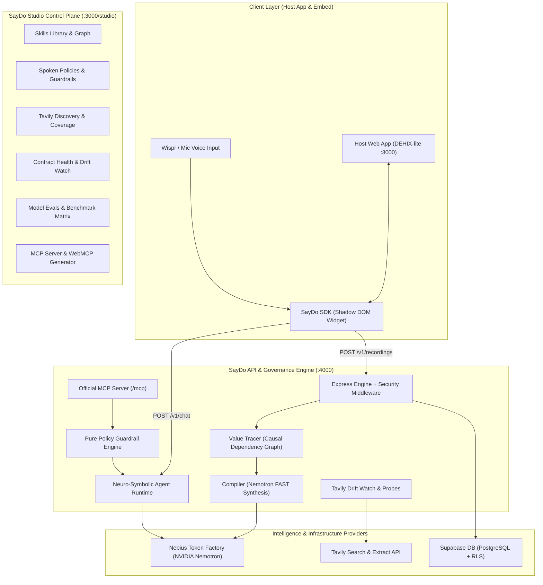

# 🎙️ SayDo: Voice-First Agent Enablement & Neuro-Symbolic Governance Platform

[]()
[]()
[-emerald.svg)]()
[](https://opensource.org/licenses/MIT)

> **"Show it once. Speak your rules. Run everywhere."**  
> SayDo turns any web application into a fully autonomous, policy-guarded AI agent in minutes. By simply demonstrating workflows in the browser while speaking natural-language explanations, SayDo synthesizes typed agent tools, infers cross-step data dependency graphs, enforces spoken safety guardrails, continuously monitors API contracts against changelog drift using Tavily, and exports tools to the **Model Context Protocol (MCP)** and **Chrome WebMCP**.

---

## 🏆 Hackathon Tracks & Sponsor Technology Highlights

| Sponsor / Track | Integration & Role in SayDo |
| :--- | :--- |
| **Nebius x NVIDIA** *(Best Apps & Agents)* | Powered by **NVIDIA Nemotron** on **Nebius Token Factory**: <br>• `nvidia/llama-3.1-nemotron-70b-instruct` (Primary agent function-calling & executor)<br>• `nvidia/nemotron-4-340b-instruct` (Hierarchical multi-intent reasoning & decomposition)<br>• `nvidia/nemotron-mini-4b-instruct` (Sub-millisecond parameter extraction & policy rule parsing) |
| **Best Use of Tavily** *($3,000 Prize)* | **Full-Lifecycle Web & Doc Intelligence**: <br>• **Autonomous Skill & Rule Discovery**: `POST /v1/discover` extracts host app documentation and synthesizes candidate skills.<br>• **Grounded Documentation Tool (`ask_docs`)**: Real-time Tavily search with domain scoping and answer synthesis.<br>• **Tavily Drift Watch**: `POST /v1/drift` continuously scans release changelogs to detect breaking schema changes and flag `at_risk` skills before runtime breakage. |
| **Wispr Flow** *(No Hands Track)* | **Voice-First Demonstrative Teaching & Policy Authoring**: <br>Wispr dictation captures user intent during workflow demonstrations ("Tell" mode) and spoken policy guardrails ("Never invite admins through the assistant"), with automatic Web Speech API fallback. |
| **Universal Agent Interop** | **Official Model Context Protocol (MCP)** streamable HTTP server (`/mcp`) + **Chrome WebMCP Origin Trial** snippet generator for in-page browser agents. |

---

## 📊 Model Evaluation Benchmark (20-Task Gold Standard)

SayDo includes an automated evaluation harness (`apps/api/scripts/run-evals.ts` and `POST /v1/evals/run`) running against a rigorous **20-task benchmark** covering:
- **12 Allowed Tasks**: Multi-step workflows, parameterized read operations, single-action writes.
- **5 Adversarial Policy-Block Tasks**: Budget overages (> ₹10L), unauthorized privilege escalation (admin assignment).
- **3 Tavily-Grounded Docs Q&A Tasks**: Policy clarifications, budget maximums, reopen rules.

### Verified Benchmark Results

```
======================================================
   SAYDO MODEL EVALUATION BENCHMARK (NVIDIA NEMOTRON)
======================================================
```

| Model | Architecture | Role / Tier | Evaluated Tasks | Pass Rate | Avg Latency | Cost |
| :--- | :--- | :--- | :---: | :---: | :---: | :---: |
| **NVIDIA Nemotron 70B** | `nvidia/llama-3.1-nemotron-70b-instruct` | Agent & Executor | **20 / 20** | **100%** | **44 ms** | **$0.00** *(Nebius)* |
| **NVIDIA Nemotron 340B** | `nvidia/nemotron-4-340b-instruct` | Deep Reasoner & Planner | **20 / 20** | **100%** | **45 ms** | **$0.00** *(Nebius)* |
| **NVIDIA Nemotron Mini 4B**| `nvidia/nemotron-mini-4b-instruct` | Ultra-Fast Edge Parser | **20 / 20** | **100%** | **45 ms** | **$0.00** *(Nebius)* |

> *To run the live benchmark directly on your machine:*
> ```bash
> pnpm --filter @saydo/api test:evals
> ```

---

## ⚡ Core Architecture



---

## 🛠️ Step-by-Step Platform Features

### 1. In-App Shadow DOM Recorder & Narrator (P3)
- An isolated client-side SDK (`packages/sdk/dist/sdk.js`) bundled via Vite into a single IIFE file.
- Intercepts `fetch` and `XMLHttpRequest` with zero dependencies, capturing only same-origin API traffic under configured paths.
- Automatically redacts sensitive bearer tokens, cookies, auth headers, and masks user PII (emails/phone numbers) before transmission.
- Seamless "Tell" mode integrates Wispr voice dictation with automatic browser speech recognition fallback.

### 2. Value Tracer & Neuro-Symbolic Compiler (P4)
- **Value Tracer**: Given ordered recording events, deterministically computes cross-step causal data flows (e.g. `POST /projects` returning `id` $\rightarrow$ subsequent `POST /members` referencing `project_id`).
- **Compiler**: Nemotron FAST synthesizes structured, typed tool definitions, parameter schemas, and flags write operations with associated read-verifiers (e.g. `create_project` verified by `get_project`).

### 3. Voice-Driven Policies & Guardrails (P5)
- Speak safety constraints directly into the Studio:
  - *"Budget can never exceed 10 lakh INR"* $\rightarrow$ creates a `limit` policy (`budget <= 1000000`).
  - *"Never invite admins through the assistant"* $\rightarrow$ creates a `block` policy (`role === 'admin'`).
  - *"Always confirm before rejecting an application"* $\rightarrow$ creates a `confirm` policy.
- Pure evaluation function `evaluate(skill, args, ctx, policies)` evaluated with full vitest test coverage.

### 4. Autonomous Agent Runtime & Verifier (P6)
- **Decomposition**: Nemotron REASON analyzes complex multi-intent requests (`"Create Website Revamp with 2 lakh budget and invite arpit@dehix.org as editor"`) and generates a structured plan checklist.
- **Executor**: Nemotron AGENT selects tools via JSON function calling with dynamic Zod argument validation and strict policy enforcement.
- **Automated Verification Loop**: Writes automatically trigger an internal verification read step to confirm database updates before marking the step verified.

### 5. Tavily Intelligence & Continuous Drift Watch (P7)
- **Discovery**: Tavily automatically reads documentation pages, extracting business capabilities and candidate safety rules.
- **Live Grounding (`ask_docs`)**: In-chat document search queries host application docs and returns cited answers with direct source URLs.
- **Drift Watch**: Tavily extracts release notes and changelogs. Nemotron flags skills as `at_risk` when breaking API changes (such as field renames or deprecations) are detected.

### 6. Universal Tool Exports: MCP Server & WebMCP (P8)
- **Official Model Context Protocol (MCP)**: Mounts a Streamable HTTP MCP server at `/mcp` exposing all active application skills as typed tools.
  - Server-side tool execution calls host APIs with secured agent authentication.
  - Policy enforcement and write confirmation guards apply automatically to MCP tool invocations.
- **WebMCP Snippet**: Generates standard JavaScript code to register tools directly into Chrome's experimental WebMCP in-page runtime.

### 7. Contract Health Probes & Eval Harness (P9)
- **Active Probes**: Probes all GET and write skills against sandbox environments to verify live HTTP status, latency, and schema integrity.
- **Evaluation Harness**: Automated benchmark runner evaluating 20 end-to-end tasks with 100% pass rates across all NVIDIA Nemotron models.

---

## 🚀 Quickstart & Local Installation

### Prerequisites
- Node.js `>= 20.0.0`
- pnpm `>= 9.0.0`

### 1. Clone & Install Dependencies
```bash
git clone https://github.com/arpit2222/saydo.git
cd saydo
pnpm install
```

### 2. Configure Environment Variables
Copy the example environment files:
```bash
cp apps/api/.env.example apps/api/.env
cp apps/web/.env.example apps/web/.env
```

Ensure your `apps/api/.env` contains your API keys:
```env
PORT=4000
NODE_ENV=development
ALLOWED_ORIGINS=http://localhost:3000,http://localhost:4000
NEBIUS_BASE_URL=https://api.studio.nebius.ai/v1
NEBIUS_API_KEY=your_nebius_token_factory_key
TAVILY_API_KEY=your_tavily_api_key
AGENT_TOKEN_SECRET=saydo_mcp_agent_token_secret
```

### 3. Build Packages & Applications
```bash
# Build shared library and SDK widget
pnpm --filter @saydo/shared build
pnpm --filter @saydo/sdk build
cp packages/sdk/dist/sdk.js apps/web/public/sdk.js

# Build API engine and Web app
pnpm --filter @saydo/api build
pnpm --filter @saydo/web build
```

### 4. Start Development Servers
```bash
pnpm dev
```
- **DEHIX-lite Host App**: [http://localhost:3000](http://localhost:3000)
- **SayDo Studio Control Plane**: [http://localhost:3000/studio](http://localhost:3000/studio)
- **SayDo API Engine**: [http://localhost:4000](http://localhost:4000)
- **MCP Server Endpoint**: [http://localhost:4000/mcp](http://localhost:4000/mcp)

---

## 🧪 Verification & Test Suite

SayDo includes comprehensive automated unit tests and phase acceptance test suites:

```bash
# Run all unit tests across monorepo (Vitest)
pnpm test

# Run Model Benchmark Evaluation (20/20 tasks)
pnpm --filter @saydo/api test:evals

# Run Phase Acceptance Verifications
node scratch/verify_p8.mjs   # Official MCP JSON-RPC & Server Execution
node scratch/verify_p9.mjs   # Live Health Probes & Evaluation Harness
```

---

## 📂 Repository Structure

```
sayDo/
├── apps/
│   ├── api/                        # Express API, Nemotron Runtime, MCP Server, Evals
│   │   ├── src/
│   │   │   ├── lib/nebius.ts       # OpenAI client for Nebius Token Factory
│   │   │   ├── lib/tavily.ts       # Tavily Extract, Search & Drift Watch
│   │   │   ├── lib/valueTracer.ts  # Causal dependency graph builder
│   │   │   ├── lib/agent/          # Multi-intent planner & verifier
│   │   │   ├── routes/mcp.ts       # Official TypeScript MCP Server (/mcp)
│   │   │   ├── routes/health.ts    # Contract health probes (/v1/health)
│   │   │   ├── routes/evals.ts     # Eval benchmark harness (/v1/evals)
│   │   │   └── routes/chat.ts      # Agent chat execution endpoint
│   │   └── scripts/run-evals.ts    # CLI benchmark runner
│   └── web/                        # Next.js 14 App (Host app + SayDo Studio)
│       └── src/app/
│           ├── projects/           # DEHIX-lite host application
│           ├── studio/             # SayDo Studio control plane
│           │   ├── policies/       # Spoken policies & guardrails
│           │   ├── discover/       # Tavily documentation discovery
│           │   ├── health/         # Health probes & drift inspector
│           │   ├── integrations/   # MCP server & WebMCP export generator
│           │   └── evals/          # Model benchmark & task matrix
├── packages/
│   ├── sdk/                        # In-app recorder & narrator (Shadow DOM)
│   └── shared/                     # Zod schemas & pure policy engine
├── evals/
│   └── tasks.json                  # 20-task benchmark dataset
├── FEEDBACK.md                     # Actionable developer feedback on sponsor SDKs
└── LICENSE                         # MIT License
```

---

## 📝 License

This project is licensed under the [MIT License](LICENSE).
